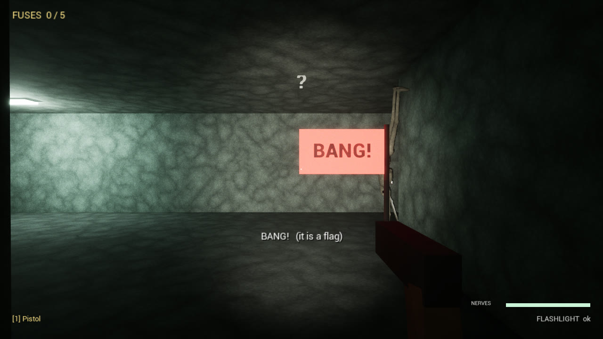
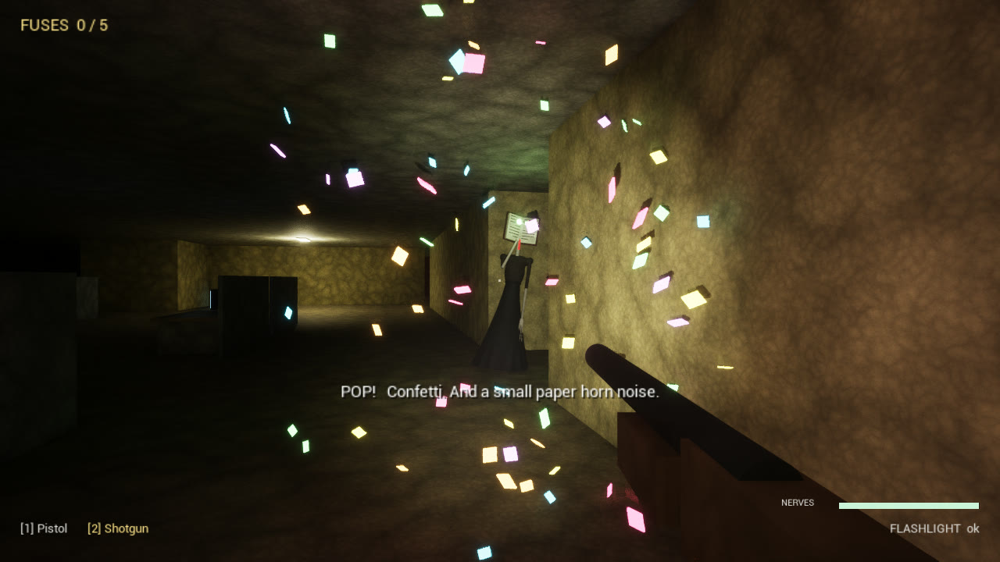
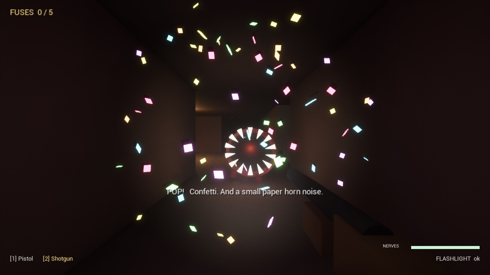
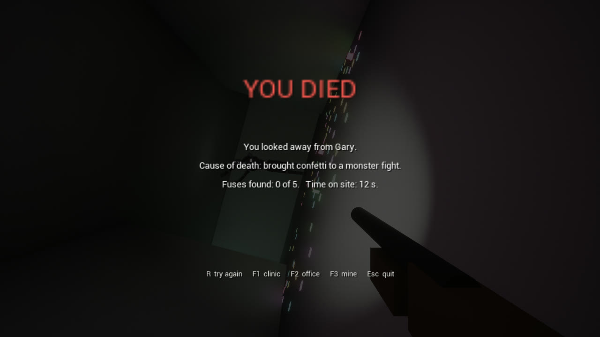

# Horror Game (Unreal Engine 5)

An open source comedy-horror game built with Unreal Engine 5.8. The monster is real. Your
weapons are not: the pistol fires a "BANG!" flag, the shotgun fires confetti, and the grenade
is a dud until long after you needed it.



## What is playable

Three previews of the same round: find 5 fuses, power the exit shutter, leave. One monster
hunts you. Nothing you carry can hurt it, but everything you carry changes what it does.

| Preview | Monster | How it works |
| --- | --- | --- |
| **The night clinic** | Gary | He always knows where you are, and only moves while you are not looking at him. Stare too long and you blink. |
| **The office** | The Librarian | Blind. Runs at any noise, and shushes it first. Walk softly; sprinting carries a long way. |
| **The mine** | The Mouth | Charges down any straight lane it shares with you. It cannot turn, so it hits the wall and has to back out. |

| | |
| --- | --- |
|  |  |

Weapons, all found on the floor:

- **Pistol**: a flag pops out. The click brings the monster to where you were standing.
- **Shotgun**: confetti. The monster goes to look at where it landed.
- **Rubber chicken**: throw it. It squeaks on every bounce and the monster follows the squeaks. Pick it up and throw it again.
- **Grenade**: a dud. It goes off 35 to 55 seconds later, wherever it ended up, and stuns anything nearby. That includes you, permanently.
- **Flashlight**: dies every half minute. Smack it. Smacking is loud.



There is no sound yet, and the monsters and props are built from basic shapes in code.
See [the game design](docs/GAME_DESIGN.md) for where it is going and [the asset list](docs/ASSETS.md)
for the free models that will replace the shapes.

## Play it

You need Unreal Engine 5.8 (Epic Games Launcher), Xcode on macOS, and [Git LFS](https://git-lfs.com).
On a fresh Xcode, Unreal also needs Apple's Metal compiler: `xcodebuild -downloadComponent MetalToolchain`.

```bash
git lfs install
```

```bash
git clone https://github.com/marginsystems/horror-game-unreal-engine-5.git
cd horror-game-unreal-engine-5
```

```bash
Scripts/play.sh
```

```bash
Scripts/play.sh office
```

```bash
Scripts/play.sh mine
```

The first start compiles the C++ module and the shaders, so give it a few minutes.
In the game, F1, F2 and F3 switch between the three previews.

| Key | Action |
| --- | --- |
| W A S D, mouse | Move, look |
| Shift | Sprint (loud) |
| Ctrl or C | Tiptoe (silent) |
| Left mouse | Use the item in your hand |
| 1 to 4, mouse wheel | Choose an item |
| F | Smack the flashlight |
| R | Try again, after the round ends |
| Esc | Quit |

The scripts are for macOS, the only platform this has been run on so far. On Windows, opening
`HorrorGame.uproject` and pressing Play should work the same way, but nobody has tried it yet.

## How it is built

Everything is C++ in [Source/HorrorGame](Source/HorrorGame) and there is no hand-made level file:

- `HGLevel` builds each place at runtime from a text map (walls, lamps, props) and answers the
  monster's grid questions: paths and line of sight. No navigation mesh.
- `HGMonster` is one actor with three behaviours.
- `HGPlayer` reads the keyboard and mouse directly, so there are no input assets.
- `HGGameMode` runs the round. `HGHUD` draws the screen with the engine font.
- The only binary asset is one material, generated by `Scripts/make-assets.sh`.

After changing the code:

```bash
Scripts/build.sh
```

```bash
Scripts/test.sh
```

`Scripts/test.sh` checks the maps and then has the game play each preview by itself with no
window: fire a weapon (the monster must come and look), collect every fuse, leave by the exit.
`Scripts/test.sh shots` renders each preview and saves pictures to `Saved/Shots/`.

## Building with an AI agent

Unreal Engine 5.8 ships an experimental MCP plugin. It and its tool sets are enabled in
`HorrorGame.uproject`, and `.mcp.json` points Claude Code at it:

```bash
Scripts/open-editor.sh
```

That opens the editor with the MCP server on `http://127.0.0.1:8000/mcp`. Start Claude Code from
the project root and the `unreal-mcp` server is there. The server listens on localhost only and
has no authentication; do not expose it to a network.

## Licence

Code and original content are under the [MIT License](LICENSE). Third-party assets keep their
own licences; see [docs/ASSETS.md](docs/ASSETS.md).
