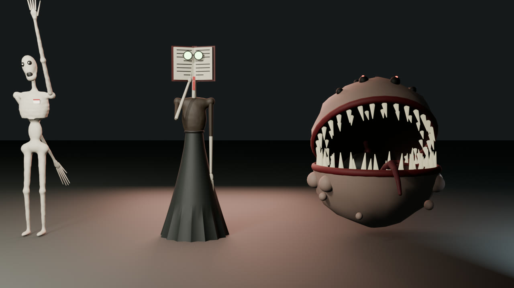

# Horror Game (Unreal Engine 5)

An open source horror game built with Unreal Engine 5.8, inspired in part by a true story.

Russia, around 1997. You are five years old, in a children's hospital, playing on the floor
of a bright ward room with your mother beside you. Then the doctors come in.

The opening is the author's own memory; the escape that follows is invented. The real part was
not unusual: children of that time and place had
operations awake, held on an adult's lap. [The story](docs/STORY.md) tells what happened, what
the game does with it, and what medical sources say about why it was done that way.

The game is being rebuilt around that story now. The first scene, the ward, can be played:
a bright children's room at a five-year-old's eye height, toys to pick up, and a shape sorter.

```bash
Scripts/play.sh
```

Everything below is the prototype: an earlier, sillier game about broken weapons that the
story replaces. `Scripts/play.sh clinic`, `office`, `mine` and `hospital` still run it.

## The prototype

Three previews of the same round: find 5 fuses, power the exit shutter, leave. One monster
hunts you. Nothing you carry can hurt it, but everything you carry changes what it does.

| Preview | Monster | How it works |
| --- | --- | --- |
| **The night clinic** | Gary | He always knows where you are, and only moves while you are not looking at him. Stare too long and you blink. |
| **The office** | The Librarian | Blind. Runs at any noise, and shushes it first. Walk softly; sprinting carries a long way. |
| **The mine** | The Mouth | Charges down any straight lane it shares with you. It cannot turn, so it hits the wall and has to back out. |

| | |
| --- | --- |
|  |  |

Weapons, all found on the floor:

- **Pistol**: a flag pops out. The click brings the monster to where you were standing.
- **Shotgun**: confetti. The monster goes to look at where it landed.
- **Rubber chicken**: throw it. It squeaks on every bounce and the monster follows the squeaks. Pick it up and throw it again.
- **Grenade**: a dud. It goes off 35 to 55 seconds later, wherever it ended up, and stuns anything nearby. That includes you, permanently.
- **Flashlight**: dies every half minute. Smack it. Smacking is loud.




The three monsters are modelled in Blender by a script and move by code, with no canned
animation. Gary is found somewhere new each time you look back: upright, down on his knuckles,
head-down on a wall or hanging from the ceiling, with his face always turned to you. The
Mouth walks on six legs that plant on the corridor walls. The Librarian's book twitches too
fast to follow. Every sound is synthesised by another script: footsteps, the four weapons, a room tone for each place, and each monster's own
noises (Gary's feet, the Librarian's heels and her "SHHH", the Mouth's growl and the
bonk when it meets a wall). You hear them from where they are, so you can listen for them.
The rooms, props and weapons are still basic shapes built in code.
See [the game design](docs/GAME_DESIGN.md) for where it is going and [the asset list](docs/ASSETS.md)
for free models that could replace the shapes.

## Private assets

The best-looking parts of the game come from asset packs whose licences allow use in a game
but not redistribution of the raw files (most Fab packs). Those live in a private repository
and are loaded as an Unreal plugin, `Plugins/HorrorPrivate`, when it is present:

```bash
Scripts/get-private-assets.sh
```

Without access to that repository the game still builds and runs, on the art its own scripts
generate. With it, Gary is a rigged, animated body (Quaternius, CC0) instead of fused shapes.

## Play it

You need Unreal Engine 5.8 (Epic Games Launcher), Xcode on macOS, and [Git LFS](https://git-lfs.com).
On a fresh Xcode, Unreal also needs Apple's Metal compiler: `xcodebuild -downloadComponent MetalToolchain`.

```bash
git lfs install
```

```bash
git clone https://github.com/marginsystems/horror-game-unreal-engine-5.git
cd horror-game-unreal-engine-5
```

```bash
Scripts/play.sh
```

```bash
Scripts/play.sh office
```

```bash
Scripts/play.sh mine
```

The first start compiles the C++ module and the shaders, so give it a few minutes.
In the game, F1, F2 and F3 switch between the three previews.

| Key | Action |
| --- | --- |
| W A S D, mouse | Move, look |
| Shift | Sprint (loud) |
| Ctrl or C | Tiptoe (silent) |
| Left mouse | Use the item in your hand |
| 1 to 4, mouse wheel | Choose an item |
| F | Smack the flashlight |
| R | Try again, after the round ends |
| Cmd+Q | Quit |

The scripts are for macOS, the only platform this has been run on so far. On Windows, opening
`HorrorGame.uproject` and pressing Play should work the same way, but nobody has tried it yet.

## How it is built

Everything is C++ in [Source/HorrorGame](Source/HorrorGame) and there is no hand-made level file:

- `HGLevel` builds each place at runtime from a text map (walls, lamps, props) and answers the
  monster's grid questions: paths and line of sight. No navigation mesh.
- `HGMonster` is one actor with three behaviours.
- `HGPlayer` reads the keyboard and mouse directly, so there are no input assets.
- `HGGameMode` runs the round. `HGHUD` draws the screen with the engine font.
- The binary assets are all generated, and `Scripts/make-assets.sh` rebuilds them:
  - one material (`make_materials.py`),
  - 32 sounds, synthesised from sine waves and noise with no recordings (`make_sounds.py`),
  - the monsters, modelled part by part in Blender (`make_models.py`; needs
    [Blender](https://www.blender.org) 4.2 or newer, only if you change the models).
  The results are committed under `Content/`, so playing needs none of this.

After changing the code:

```bash
Scripts/build.sh
```

```bash
Scripts/test.sh
```

`Scripts/test.sh` checks the maps and then has the game play each preview by itself with no
window: fire a weapon (the monster must come and look), collect every fuse, leave by the exit.
It fails if a sound or a model the game asks for is missing.
`Scripts/test.sh shots` renders each preview and saves pictures to `Saved/Shots/`.

## Building with an AI agent

Unreal Engine 5.8 ships an experimental MCP plugin. It and its tool sets are enabled in
`HorrorGame.uproject`, and `.mcp.json` points Claude Code at it:

```bash
Scripts/open-editor.sh
```

That opens the editor with the MCP server on `http://127.0.0.1:8000/mcp`. Start Claude Code from
the project root and the `unreal-mcp` server is there. The server listens on localhost only and
has no authentication; do not expose it to a network.

## Licence

Code and original content are under the [MIT License](LICENSE). Third-party assets keep their
own licences; see [docs/ASSETS.md](docs/ASSETS.md).
